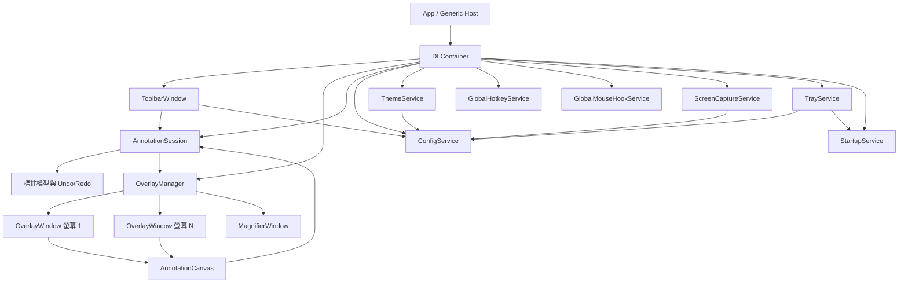

# 系統架構與技術文件

本文件描述 mini螢幕筆記（MiniScreenNotes）的技術架構、主要元件、資料流與平台整合方式。

## 1. 技術基線

| 項目 | 內容 |
| --- | --- |
| 語言 | C#（nullable reference types、file-scoped namespace） |
| 執行環境 | .NET 10（`net10.0-windows`） |
| UI 框架 | WPF + MVVM |
| 應用程式啟動 | `Microsoft.Extensions.Hosting` Generic Host |
| 依賴注入 | `Microsoft.Extensions.DependencyInjection` |
| 記錄 | `Microsoft.Extensions.Logging`（Debug 輸出 `Debug` provider） |
| 單元測試 | xUnit |
| 建置設定 | `Directory.Build.props`、Central Package Management |
| 平台 | x64、ARM64（非 Self-Contained 發行） |
| 最低系統 | Windows 10 1809（Build 17763） |

### 專案相依

```text
MiniScreenNotes.csproj
  Microsoft.Extensions.Hosting 10.0.0
MiniScreenNotes.Tests.csproj
  Microsoft.NET.Test.Sdk 17.13.0
  xunit 2.9.3
  xunit.runner.visualstudio 3.0.2
```

所有套件版本集中於 `Directory.Packages.props`，專案檔不寫死版本。

## 2. 整體架構



### 分層

| 層級 | 位置 | 職責 |
| --- | --- | --- |
| 呈現層 | `Views/`、`ViewModels/` | 視窗、覆蓋畫布、工具面板、設定與關於視窗 |
| 應用服務層 | `Services/` | 設定、主題、標註工作階段、擷取、全域輸入、系統匣、啟動 |
| 領域模型層 | `Models/`、`Models/Annotations/` | 設定模型、工具列舉、標註元素與可復原命令 |
| 平台整合層 | `Helpers/` | Win32 P/Invoke、DPI 列舉、螢幕擷取、吸附計算 |
| 資源層 | `Resources/` | 主題字典、樣式、圖示、繁體中文字串 |

## 3. 啟動流程

`App.OnStartup` 的流程如下：

1. 建立具名 Mutex `Local\Com.MiniScreenNotes.SingleInstance`。
2. 若已存在實例，透過 `Local\Com.MiniScreenNotes.ActivateSignal` 通知既有實例顯示面板，然後結束。
3. 建立 Generic Host，註冊所有服務與視窗。
4. 從 `ConfigService` 讀取使用中組態，套用主題與繪圖偏好。
5. 初始化 `OverlayManager`，為每個螢幕建立一個 `OverlayWindow`。
6. 建立 `ToolbarWindow`，串接設定、面板可見性、Z-Order 與面板邊界事件。
7. 註冊全域快捷鍵與低階滑鼠掛鉤。
8. 初始化系統匣，啟動單一實例啟用訊號監聽。
9. 若未使用 `--minimized`，顯示並還原面板位置。
10. 註冊 UI 執行緒未處理例外事件，寫入本機錯誤記錄。

### 單一實例

- Mutex 名稱：`Local\Com.MiniScreenNotes.SingleInstance`
- 啟用訊號：`Local\Com.MiniScreenNotes.ActivateSignal`
- 第二次啟動會開啟既有事件並 `Set()`，既有實例的背景執行緒收到訊號後在 UI 執行緒呼叫 `ShowAndRestorePosition()`。

### 關閉流程

`OnExit` 會依序停止並釋放低階滑鼠掛鉤、全域快捷鍵、覆蓋層、系統匣，停止 Host，最後釋放 Mutex。面板關閉按鈕只隱藏面板，真正結束需從系統匣選單選擇「結束應用程式」。

## 4. 視窗與覆蓋層策略

### ToolbarWindow

- 單一實例的浮動工具面板。
- 依面板組態動態建立工具按鈕格線。
- 支援拖曳、吸附、自動隱藏、展開／收合動畫與 Z-Order 維持。
- 提供 `PanelVisibilityChanged` 事件，讓覆蓋層跟隨面板顯示／隱藏。
- 每個組態各自保存 `LastPanelLeft`、`LastPanelTop`、`LastDockEdge`。

### OverlayWindow

- 每個實體螢幕建立一個，覆蓋該螢幕的完整範圍。
- 內含 `AnnotationCanvas`、`LaserOverlayLayer`、`SpotlightOverlayLayer` 與文字輸入方塊。
- 依目前工具切換互動狀態：
  - 游標模式：設定 `WS_EX_TRANSPARENT`，滑鼠事件穿透。
  - 標註模式：取消穿透，接收繪製事件。
- 游標為 `None` 時可隱藏系統游標，適合雷射筆、聚光燈與放大鏡。
- 螢幕設定變更時由 `OverlayManager` 重建所有覆蓋層。

### MagnifierWindow

- 全域單一放大鏡視窗，跟隨滑鼠位置。
- 使用 `CompositionTarget.Rendering` 與 VSync 同步更新。
- 以可重用 `CreateDIBSection` 緩衝區與 `WriteableBitmap` 降低逐幀配置。
- 使用 `SetWindowPos` 以實體像素一次定位，減少高 DPI 下的抖動。
- 預設倍率 2.5x，範圍 1x～10x；鏡頭直徑 200～500 DIP。
- 大於等於 3x 時使用 `NearestNeighbor` 保持像素銳利，其餘使用高品質縮放。
- 視窗設定為點擊穿透、不啟用，並嘗試排除於螢幕擷取。

### 其他視窗

| 視窗 | 用途 |
| --- | --- |
| `SettingsWindow` | 三頁籤設定與面板組態管理 |
| `AboutWindow` | 版本、授權與隱私說明 |
| `ToastWindow` | 複製／儲存／重設步驟等短暫提示 |

### Z-Order

為避免放大鏡上方疊出原始線條或面板被遮擋，程式維持固定順序：

```text
ToolbarWindow > MagnifierWindow > OverlayWindow
```

- `OverlayWindow` 取得焦點時會通知 `OverlayManager`。
- `OverlayManager` 呼叫 `BringToTopMostNoActivate` 將放大鏡與面板帶回最上層，且不搶奪焦點。

## 5. 多螢幕與 DPI

`DisplayMonitorHelper` 使用 `EnumDisplayMonitors` 列舉螢幕，並以 `GetDpiForMonitor(MDT_EFFECTIVE_DPI)` 取得有效 DPI。

`MonitorInfo` 同時保存：

- 實體像素邊界 `PhysicalBounds`
- 實體工作區 `PhysicalWorkArea`
- DPI 縮放比例 `DpiScaleX`、`DpiScaleY`
- 換算後的 DIP 邊界 `DipBounds` 與 `DipWorkArea`

WPF 視窗使用 DIP 定位；螢幕擷取使用實體像素區域。應用程式 Manifest 啟用 Per-Monitor V2：

```xml
<ApplicationHighDpiMode>PerMonitorV2</ApplicationHighDpiMode>
```

多螢幕交界處的滑動動畫會搭配 `ClipToBounds` 與 `TranslateTransform`，避免面板動畫穿透到相鄰螢幕。

## 6. 標註模型與復原機制

### 元素介面

所有標註元素實作 `IAnnotationElement`：

```csharp
public interface IAnnotationElement
{
    string MonitorId { get; }
    void Render(DrawingContext dc);
    bool HitTest(Point point, double tolerance);
}
```

目前元素類型：

| 類型 | 說明 |
| --- | --- |
| `FreehandStroke` | 畫筆與螢光筆；二次貝茲中點插值平滑化 |
| `ShapeAnnotation` | 直線、箭頭、矩形、橢圓 |
| `StampAnnotation` | 綠色打勾、紅色打叉 |
| `TextAnnotation` | 文字標註 |
| `StepNumberAnnotation` | 步驟編號 |

### AnnotationSession

`AnnotationSession` 是標註狀態的唯一來源，負責：

- 維護標註元素清單。
- 游標模式與目前標註工具的分離狀態。
- 目前顏色、線寬、標註可見性、背景模式。
- 步驟編號計數。
- Undo／Redo 堆疊。
- 透過 `StateChanged` 與 `ElementsChanged` 通知 UI 更新。

游標模式設計：

- `IsCursorMode` 與 `SelectedAnnotationTool` 分開保存。
- 關閉游標模式時會恢復原本選取的標註工具。
- 滑鼠中鍵切換只改變 `IsCursorMode`，不覆寫工具選取。

### Undo／Redo

所有變更都封裝為 `IUndoableAction`：

| 命令 | 說明 |
| --- | --- |
| `AddAnnotationAction` | 新增元素 |
| `RemoveAnnotationsAction` | 移除一或多個元素，保留原索引 |
| `ClearAnnotationsAction` | 清除全部元素 |

- 新動作會清空 Redo 堆疊。
- 復原／重做後會重新計算最大步驟編號。
- 清除與擦除皆可復原。

## 7. 設定與組態

### 儲存位置

```text
%AppData%\MiniScreenNotes\config.json
```

### 寫入策略

1. 序列化為縮排 JSON，列舉以字串輸出。
2. 寫入 `config.json.tmp`。
3. 以 `File.Move(..., overwrite: true)` 原子取代正式檔。

可避免寫入中斷造成設定檔損毀。

### 模型

`AppConfig` 包含：

- 使用中組態 ID 與組態清單
- 全域快捷鍵修飾鍵與虛擬鍵
- 快速儲存開關、資料夾、格式與上次儲存資料夾
- 開機自動啟動
- 上次顏色與線寬

`PanelProfile` 包含：

- 名稱、尺寸、方向、顯示模式、主題
- 每列／每行工具數量上限
- 自動隱藏開關與延遲秒數
- 各組態獨立的面板位置與吸附邊緣
- 工具顯示與排序清單

舊版設定若只有全域面板位置，載入時會自動遷移至目前組態。若組態為空或工具項目缺少，會自動補齊，避免舊設定造成錯誤。

## 8. 主題系統

- `ThemeService` 動態替換 `Application.Current.Resources.MergedDictionaries` 中的主題字典。
- 主題檔命名規則：`Resources/Themes/{ThemeName}.{Light|Dark}.xaml`。
- `DisplayMode.FollowSystem` 會讀取登錄檔 `AppsUseLightTheme` 判斷系統明暗。
- 切換主題後會對所有開啟中的視窗套用 DWM 深色標題列。
- 程式碼與 XAML 以 `DynamicResource` 引用主題資源，確保執行中切換即時生效。

目前提供 10 種主題，每種皆有淺色與深色版本。

## 9. 邊緣吸附與面板動畫

`DockSnapHelper` 為純函式工具，方便單元測試：

| 方法 | 用途 |
| --- | --- |
| `DetectDockEdge` | 依方向與 24 DIP 門檻判斷可吸附邊緣 |
| `GetDockedExpandedPosition` | 計算吸附後展開座標並限制在螢幕內 |
| `GetHiddenHandlePosition` | 計算收合小手把位置 |
| `ClampToAvailableMonitors` | 將面板拉回可用螢幕範圍 |
| `CalculateGridDimensions` | 依工具數與上限計算欄列數 |
| `GetSlideOffset` | 計算移入／移出動畫位移向量 |

動畫使用 `TranslateTransform` 與 `Opacity`，並以狀態機處理動畫中途反向切換。開始新動畫前會取消舊動畫並讀回目前值，避免 WPF `HoldEnd` 鎖定屬性。

## 10. 全域輸入

### 全域快捷鍵

- 使用 `RegisterHotKey` 與隱藏訊息視窗 `HwndSource`。
- 預設 `Ctrl+Alt+A`。
- 加入 `MOD_NOREPEAT` 避免長按重複觸發。
- 註冊失敗會記錄警告，設定頁顯示狀態訊息。

### 低階滑鼠掛鉤

- 使用 `WH_MOUSE_LL` 攔截中鍵。
- 僅在浮動面板可見時處理，其餘時間完全透傳。
- 收到中鍵後透過 `Dispatcher.BeginInvoke` 在 UI 執行緒切換游標模式。

## 11. 螢幕擷取與輸出

`ScreenCaptureHelper.CapturePhysicalRegion` 使用 GDI：

1. `GetDC(NULL)` 取得螢幕 DC。
2. 建立相容 DC 與點陣圖。
3. `BitBlt` 搭配 `SRCCOPY | CAPTBLT` 擷取實體像素區域。
4. 轉為凍結的 `BitmapSource`。
5. 釋放所有 GDI 資源。

`ScreenCaptureService` 負責：

- 依 `MonitorInfo.PhysicalBounds` 擷取目前螢幕。
- 複製到剪貼簿。
- 一般儲存對話框（PNG／JPEG）。
- 快速儲存（PNG 或 JPEG 品質 92）。
- 透過 `NotificationRequested` 顯示提示。

## 12. 錯誤處理與記錄

- 啟動階段例外會寫入 `%AppData%\MiniScreenNotes\error.log`，顯示錯誤訊息後正常結束。
- UI 執行緒未處理例外會記錄並標記為已處理，避免程式直接崩潰。
- 服務層例外使用 `ILogger` 記錄；正式版不輸出到主控台。
- 設定檔讀取失敗會回退至預設組態，不覆寫損毀檔案。

## 13. 隱私與安全

- 不包含網路用戶端、遙測或帳號機制。
- 不收集螢幕內容、鍵盤輸入或使用統計。
- 全域滑鼠掛鉤僅處理中鍵，且只在面板可見時生效。
- 設定與錯誤記錄僅存放於使用者本機 `%AppData%`。
- 程式以 `asInvoker` 執行，不要求系統管理員權限。

## 14. 建置與平台

| 目標 | Runtime Identifier | Self-Contained |
| --- | --- | --- |
| x64 | `win-x64` | 否 |
| ARM64 | `win-arm64` | 否 |

非 Self-Contained 發行需使用者安裝 .NET 10 Desktop Runtime。專案不支援 Windows 10 1809 以下的作業系統，且部分擷取排除功能需 Windows 10 2004 以上。

## 15. 已知限制

- `WDA_EXCLUDEFROMCAPTURE` 需 Windows 10 2004（Build 19041）以上；較舊版本可執行，但截圖與放大鏡排除浮動面板的效果會降級。
- 部分滑鼠驅動程式可能攔截中鍵，導致全域游標模式切換無效。
- 全域快捷鍵若被其他程式占用，需改用其他組合。
- 未進行程式碼簽章，SmartScreen 可能顯示未知發行者警告。
- 尚未於所有混合 DPI 與多螢幕組合進行實機驗證。
