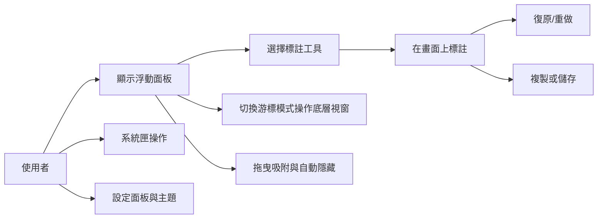
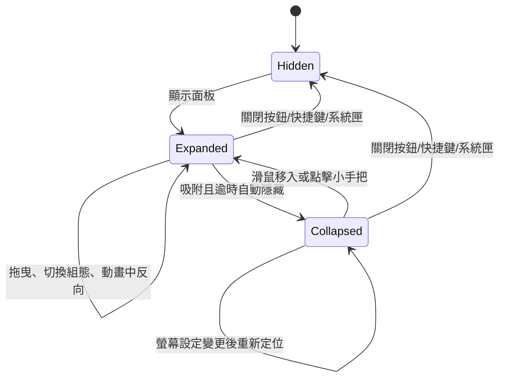
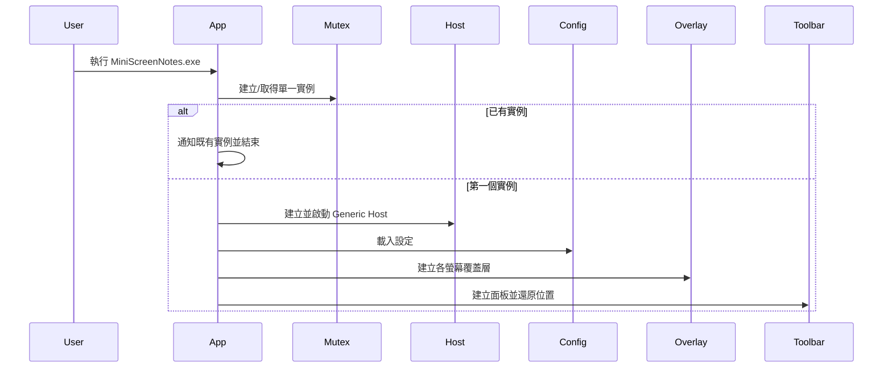
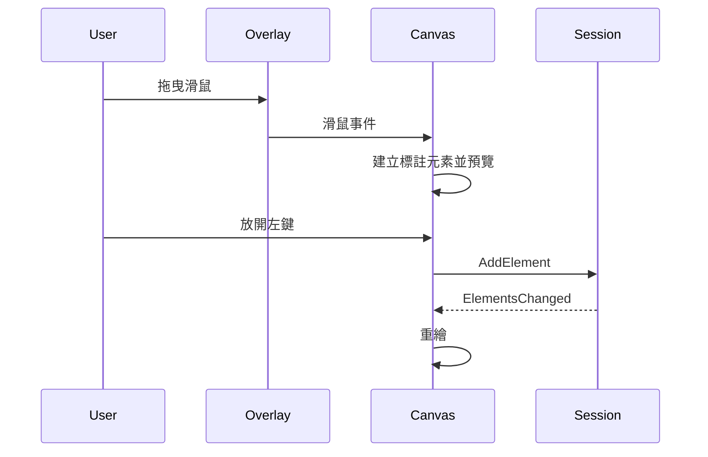
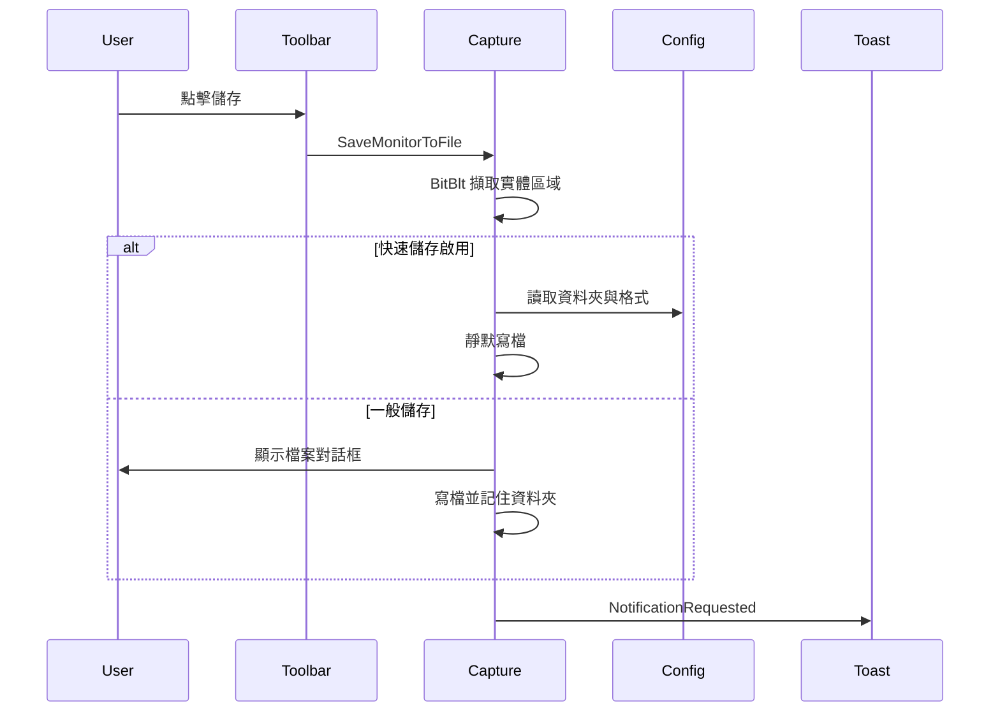

# 系統設計文件

本文件說明 mini螢幕筆記（MiniScreenNotes）的設計目標、需求、狀態模型、資料設計、互動流程與測試策略。

## 1. 目的與範圍

### 1.1 目的

提供一個常駐 Windows 系統匣的輕量螢幕標註工具，讓使用者能在任何應用程式畫面上快速繪製、標記與簡報，不需切換視窗或安裝額外外掛。

### 1.2 範圍

包含：

- 多螢幕透明標註覆蓋層
- 16 種標註與簡報工具
- 可吸附、自動隱藏的浮動工具面板
- 多組面板組態與主題
- 螢幕擷取、複製與儲存
- 系統匣、全域快捷鍵與開機啟動

不包含：

- 雲端同步、帳號或協作功能
- 影像編輯器等級的圖層與濾鏡
- 安裝程式或自動更新
- 行動裝置或非 Windows 平台

### 1.3 目標使用者

- 教師與講師：直接在簡報或教材上標註
- 遠端會議參與者：指出畫面重點
- 技術支援人員：引導使用者操作
- 一般使用者：快速圈選、截圖與分享

## 2. 需求

### 2.1 功能性需求

| 編號 | 需求 | 優先級 |
| --- | --- | --- |
| FR-01 | 在所有實體螢幕上建立透明標註覆蓋層 | 高 |
| FR-02 | 支援畫筆、螢光筆、直線、箭頭、矩形、橢圓、打勾、打叉、文字、步驟編號、橡皮擦 | 高 |
| FR-03 | 支援雷射筆、聚光燈與 1x～10x 放大鏡 | 高 |
| FR-04 | 游標模式可讓滑鼠事件穿透至底層視窗 | 高 |
| FR-05 | 支援復原與重做，包含新增、擦除與清除 | 高 |
| FR-06 | 支援複製目前螢幕標註到剪貼簿 | 高 |
| FR-07 | 支援儲存 PNG／JPEG 與一鍵快速儲存 | 中 |
| FR-08 | 浮動面板可拖曳、吸附螢幕邊緣並自動隱藏 | 高 |
| FR-09 | 面板尺寸、方向、工具顯示與排序可自訂 | 中 |
| FR-10 | 支援多組面板組態並各自記憶位置 | 中 |
| FR-11 | 提供淺色、深色、跟隨系統與 10 種主題 | 中 |
| FR-12 | 系統匣常駐與右鍵選單操作 | 高 |
| FR-13 | 全域快捷鍵顯示／隱藏面板，可自訂 | 高 |
| FR-14 | 滑鼠中鍵切換游標模式 | 低 |
| FR-15 | 開機自動啟動並以最小化模式常駐 | 低 |
| FR-16 | 單一實例，重複啟動時喚出既有面板 | 中 |
| FR-17 | 螢幕設定變更時自動重建覆蓋層 | 中 |
| FR-18 | 面板位置在多螢幕變更後仍位於可見範圍 | 中 |

### 2.2 非功能性需求

| 類別 | 需求 |
| --- | --- |
| 效能 | 繪製與移動需低延遲；放大鏡以 VSync 更新，避免逐幀配置 |
| 記憶體 | 放大鏡重用 DIB 緩衝區；標註幾何快取 |
| 相容性 | Windows 10 1809 以上、x64 與 ARM64 |
| DPI | 支援 Per-Monitor DPI v2 與混合 DPI 多螢幕 |
| 可靠性 | 設定檔原子寫入；啟動失敗需記錄且不得殘留背景進程 |
| 可用性 | 面板操作直覺；破壞性操作需確認；提供空狀態與錯誤提示 |
| 隱私 | 不連網、不收集遙測、不上傳畫面 |
| 可維護性 | 分層架構、依賴注入、單元測試、集中套件版本 |
| 可存取性 | 可點擊元素具備 ToolTip 與自動化名稱 |

## 3. 系統情境

### 3.1 主要使用案例



### 3.2 典型流程

**快速標註**

1. 按 `Ctrl+Alt+A` 顯示面板。
2. 選擇畫筆或箭頭。
3. 在畫面上拖曳。
4. 點擊複製或儲存按鈕輸出。
5. 切換回游標模式繼續操作。

**簡報模式**

1. 切換至「簡報精簡（直向側邊）」組態。
2. 面板吸附右緣並自動隱藏。
3. 使用雷射筆、聚光燈或放大鏡。
4. 滑鼠移入小手把可臨時展開更換工具。

**多螢幕切換**

1. 程式為每個螢幕建立覆蓋層。
2. 使用者在不同螢幕繪製，標註以 `MonitorId` 區分。
3. 複製或儲存時以游標所在螢幕為目標。

## 4. 系統狀態設計

### 4.1 面板狀態



重點規則：

- 只有吸附中的面板會自動收合。
- 收合為小手把不影響標註顯示。
- 隱藏面板會同步隱藏標註與背景。
- 重新顯示面板會恢復原本標註可見性。

### 4.2 標註工作階段狀態

| 狀態 | 說明 |
| --- | --- |
| `IsCursorMode` | 是否為滑鼠穿透模式 |
| `SelectedAnnotationTool` | 上次選取的標註工具 |
| `CurrentTool` | 游標模式時為 `Cursor`，否則為 `SelectedAnnotationTool` |
| `AnnotationsVisible` | 是否顯示標註 |
| `BackgroundMode` | 透明、白板、黑板 |
| `CurrentColor` | 目前顏色 |
| `StrokeWidth` | 目前線寬（1～30） |
| `NextStepNumber` | 下一個步驟編號 |

狀態變更會觸發 `StateChanged`，由 `OverlayManager` 與 `ToolbarWindow` 更新畫面。

### 4.3 復原堆疊

```text
Undo Stack          Redo Stack
[Add A]             []
[Add B]             []
[Remove A]          []

Undo -> Undo Stack [Add B], Redo Stack [Remove A]
Redo -> Undo Stack [Add B, Remove A], Redo Stack []
```

新增動作會清空 Redo Stack。清除與擦除以批次命令保存原索引，復原時可回到正確位置。

## 5. 介面設計

### 5.1 浮動面板

```text
+--------------------------------------------------+
| [工具] [工具] [工具] [工具] [工具] [工具] [設定][X] |
| [工具] [工具] [工具] [工具] [工具] [工具]          |
+--------------------------------------------------+
```

- 工具按鈕依組態動態產生。
- 固定控制項（設定、關閉）與工具格線分離，避免占用過多空間。
- 直向面板時固定控制項移至底部。
- 吸附收合後只顯示小手把：

```text
橫向吸附：      ──────
直向吸附：      │
```

### 5.2 覆蓋畫布堆疊

```text
OverlayWindow (每個螢幕)
  ├─ BackgroundLayer（透明／白板／黑板）
  ├─ AnnotationCanvas（標註元素）
  ├─ LaserOverlayLayer（雷射拖尾）
  ├─ SpotlightOverlayLayer（聚光燈遮罩）
  └─ InlineTextBox（文字輸入）
```

### 5.3 設定視窗

| 分頁 | 內容 |
| --- | --- |
| 面板與外觀 | 尺寸、方向、顯示模式、主題、工具上限、自動隱藏 |
| 工具項目與排序 | 工具顯示勾選、上移／下移、全部顯示 |
| 快捷鍵與系統 | 全域快捷鍵、快速儲存、開機啟動 |

組態管理列提供複製新增、重新命名與刪除。

## 6. 資料設計

### 6.1 設定檔結構

```json
{
  "ActiveProfileId": "…",
  "Profiles": [
    {
      "Id": "…",
      "Name": "完整標註（橫向）",
      "Size": "Medium",
      "Orientation": "Horizontal",
      "DisplayMode": "FollowSystem",
      "Theme": "YellowEyeCare",
      "MaxItemsPerLine": 9,
      "AutoHideWhenDocked": true,
      "AutoHideDelaySeconds": 2.0,
      "LastPanelLeft": 100.0,
      "LastPanelTop": 0.0,
      "LastDockEdge": "Top",
      "Tools": [
        { "Tool": "Cursor", "IsVisible": true }
      ]
    }
  ],
  "HotkeyModifiers": 3,
  "HotkeyVirtualKey": 65,
  "QuickSaveEnabled": false,
  "QuickSaveDirectory": "C:\\Users\\…\\Pictures\\MiniScreenNotes",
  "QuickSaveFormat": "Png",
  "LaunchAtStartup": false,
  "SelectedColorHex": "#EF4444",
  "StrokeWidth": 4.0
}
```

### 6.2 資料一致性

- 載入時補齊缺少的工具項目，預設為隱藏。
- 若沒有有效組態，建立兩組預設組態。
- 若使用中組態 ID 不存在，改用第一組。
- 舊版全域位置自動遷移至目前組態。
- 寫入採暫存檔加原子搬移。

### 6.3 本機資料

| 資料 | 路徑 | 是否可刪除 |
| --- | --- | --- |
| 設定 | `%AppData%\MiniScreenNotes\config.json` | 可，會重建預設值 |
| 錯誤記錄 | `%AppData%\MiniScreenNotes\error.log` | 可 |
| 快速儲存圖片 | 使用者指定資料夾 | 可 |

## 7. 互動流程

### 7.1 啟動



### 7.2 繪製



### 7.3 儲存



### 7.4 顯示設定變更

1. `SystemEvents.DisplaySettingsChanged` 觸發。
2. `OverlayManager` 在 UI 執行緒關閉舊覆蓋層。
3. 重新列舉螢幕並建立新覆蓋層。
4. 依目前可見狀態顯示或隱藏。
5. 面板在下次顯示時校正至可用螢幕範圍。

## 8. 效能設計

| 項目 | 策略 |
| --- | --- |
| 畫筆平滑 | 以中點二次貝茲曲線建立 `StreamGeometry` 並快取 |
| 繪製更新 | 僅在變更時 `InvalidateVisual` |
| 雷射拖尾 | `CompositionTarget.Rendering` 搭配時間戳淘汰舊點 |
| 放大鏡 | 重用 DIB 區段與 `WriteableBitmap`，避免逐幀配置 |
| 放大鏡定位 | 單次 `SetWindowPos`，以實體像素對齊 |
| 螢幕列舉 | 僅在啟動與顯示設定變更時執行 |
| 設定儲存 | 非同步需求低，採短暫同步寫入並以暫存檔保護 |

## 9. 錯誤處理設計

| 情境 | 處理 |
| --- | --- |
| 啟動例外 | 寫入 `error.log`、顯示訊息、正常結束 |
| UI 例外 | 記錄、標記已處理、避免崩潰 |
| 設定檔損毀 | 記錄警告、回退預設組態 |
| 快捷鍵註冊失敗 | 記錄警告、設定頁顯示狀態 |
| 擷取失敗 | 記錄錯誤、回傳失敗、不顯示成功提示 |
| 儲存失敗 | 記錄錯誤、保留原設定 |

## 10. 測試策略

### 10.1 單元測試

目前測試涵蓋：

| 測試檔 | 內容 |
| --- | --- |
| `UndoRedoTests` | 新增、復原、重做、清除、擦除、游標模式切換 |
| `ConfigServiceTests` | 設定持久化、DI 解析、主題、尺寸、重新命名、多組態位置 |
| `DockSnapHelperTests` | 吸附邊緣、位置校正、格線計算、動畫位移 |

執行：

```powershell
dotnet test MiniScreenNotes.sln
```

### 10.2 手動驗證清單

- 多螢幕與混合 DPI（100%、150%、200%）
- Windows 10 1809 與 Windows 11
- x64 與 ARM64 裝置
- 快捷鍵衝突與中鍵切換
- 面板吸附、動畫中反向、螢幕拔除
- 放大鏡跨螢幕移動與高倍縮放
- 截圖是否排除面板與放大鏡
- 快速儲存資料夾權限不足時的錯誤提示

## 11. 部署設計

| 項目 | 設計 |
| --- | --- |
| 發行形式 | 非 Self-Contained zip，不提供安裝檔 |
| 目標平台 | `win-x64`、`win-arm64` |
| 執行環境 | 使用者需安裝 .NET 10 Desktop Runtime |
| 更新方式 | 手動下載新版本覆蓋 |
| 設定延續 | 設定存放於 `%AppData%`，覆蓋程式不影響設定 |
| 簽章 | 目前未簽章 |

## 12. 設計取捨與風險

| 項目 | 取捨 | 風險／緩解 |
| --- | --- | --- |
| 每個螢幕一個覆蓋視窗 | 簡化多螢幕座標與裁剪 | 螢幕變更需重建，已由事件處理 |
| 以 WPF 繪製標註 | 開發快速、易整合 | 大量元素時效能需注意，已快取幾何 |
| GDI BitBlt 擷取 | 相容性高、可取得實體像素 | 不包含部分硬體疊層，需實機驗證 |
| 低階滑鼠掛鉤 | 可全域切換中鍵 | 可能被防毒或驅動攔截，僅面板可見時處理 |
| 非 Self-Contained | 檔案較小 | 使用者需自行安裝 Runtime |
| 未簽章 | 省去憑證成本 | SmartScreen 警告，文件已說明 |

## 13. 後續擴充方向

- 增加更多標註元素（多邊形、螢光筆疊色模式）
- 自訂快捷鍵組合與多組快捷鍵
- 匯出錄影或 GIF
- 多語系資源
- 程式碼簽章與自動更新
- 更完整的多螢幕混合 DPI 自動化測試
